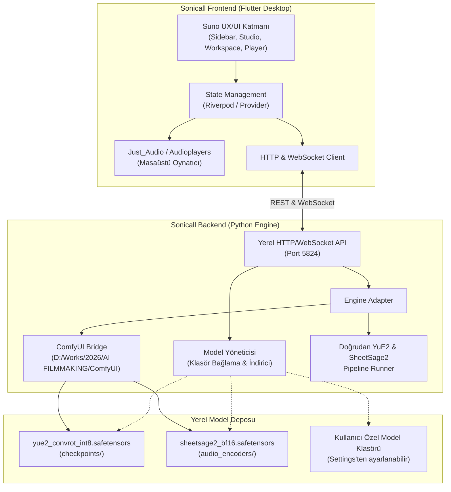

# Sonicall: AI Music & Cover Studio — Implementation Plan
**Şirket:** Trunçgil Teknoloji  
**Ürün Adı:** Sonicall (AI Music & Cover Studio)  
**Hedef Platform:** Windows Desktop (Microsoft Store uyumlu) & Web  
**Teknoloji Yığını:** Flutter (Desktop Frontend) + Python (Local YuE2 & ComfyUI Engine Backend)  
**Yapay Zeka Modelleri:** YuE2 (3B INT8 ConvRot / BF16) + SheetSage2 (Melody Transcriber)

---

## 1. Vizyon ve Genel Bakış

**Sonicall**, Suno v5/v6 ve Udio kalitesinde müzik üretimini ve şarkı cover yapma deneyimini **tamamen yerel bilgisayarda (özellikle NVIDIA RTX serisi GPU'larda)**, sıfır abonelik ücretiyle ve sınırsız yaratıcı özgürlükle sunan profesyonel bir masaüstü AI ses iş istasyonudur (DAW).

### Temel Hedefler:
1. **Suno ile Birebir UX/UI Deneyimi:** Kullanıcının alışık olduğu 3 panelli Suno arayüzünü (Sol Gezinme Menüsü, Orta Üretim Stüdyosu, Sağ Çalışma Alanı & Şarkı Listesi ve Altta Sürekli Çalan Müzik Çalar) piksel seviyesinde yüksek doğrulukla sunmak.
2. **Karanlık ve Aydınlık Mod (Dark/Light):** Varsayılan modern stüdyo karanlık teması (`#0E0E10`) ve şık aydınlık tema.
3. **Şarkı Cover Yeteneği (Melody Transfer):** `SheetSage2` ile herhangi bir referans ses parçasından melodiyi çıkarıp, YuE2 ile yeni vokal ve tarzda yeniden seslendirme.
4. **Yasal & Mağaza Uyumu (CC-BY-NC 4.0 & BYOM):** Model ağırlıklarını uygulama paketine gömmeyerek Microsoft Store onayını kolaylaştıran; kullanıcıya modelleri sonradan indirme veya mevcut klasörü (`D:\Works\2026\AI FILMMAKING\ComfyUI\models`) bağlama seçeneği sunan esnek mimari.

---

## 2. Kullanıcı Arayüzü (UI/UX) ve Tasarım Mimarisi

Suno arayüzü referans alınarak tasarlanan 3 panelli masaüstü düzeni:

```
┌───────────┬───────────────────────────────┬────────────────────────────────────────────────────────┐
│  SONICALL │ 🎵 Songs | 🎙️ Speech | 🔊 Sound│ Workspaces > My Workspace                 [Share] ⚙️   │
│           ├───────────────────────────────┼────────────────────────────────────────────────────────┤
│ 🏠 Home   │ [ Simple ] [ Advanced ]  v6 ▾ │ 🔍 Search...   [Filters (3)] [New ▾] [List/Grid]       │
│ 🔍 Explore│                               ├────────────────────────────────────────────────────────┤
│ 🎵 Create │ [+ Audio]  [+ Voice]  [+ Inspo│ Dün                                                    │
│ 🎛️ Studio │                               │  ┌────┐  Mevsimler [v6] [COVER]                        │
│ 📚 Library│ ▾ Lyrics                      │  │ 🖼️ │  Alternative hip-hop, open room reverb...      │
│           │ [ Start writing lyrics...   ] │  │3:05│  👍 👎 🔗 ...                                  │
│ 👤 Profil │                               │  └────┘                                                │
│           │ ▾ Style of Music              │ Pazar                                                  │
│           │ [ Synthwave, 80s drums...   ] │  ┌────┐  Mevsimler [v6] [COVER]                        │
│ ⚙️ Ayarlar│                               │  │ 🖼️ │  Emotional oriental melody with rock chorus    │
│ 📥 Modeller│ [⚙️ Seçenekler]   [ 🎵 Create ]│  │3:18│  👍 👎 🔗 ...                                  │
└───────────┴───────────────────────────────┴────────────────────────────────────────────────────────┘
│ ◀ ⏸ ▶  [01:14 ────────●──────────────── 03:05] 🔊 ──●── [🔁 Tekrar] [📝 Sözler] [⬇️ İndir]         │
└────────────────────────────────────────────────────────────────────────────────────────────────────┘
```

### A. Sol Gezinme Menüsü (Collapsible Sidebar)
- **Marka Logosu:** "SONICALL" (Trunçgil Turuncusu ve Neon Ses Dalgası ikonografisi)
- **Navigasyon Butonları:** Home, Explore, **Create** (Varsayılan aktif sekme), Studio, Library.
- **Kullanıcı / Durum Kartı:** Kullanıcı profil resmi, model çalışma durumu (GPU VRAM göstergesi).
- **Alt Araçlar:** Model Yöneticisi (`Model Hub`), Ayarlar (Tema seçimi: Dark/Light, Model klasörü seçimi).

### B. Orta Üretim Paneli (Creation Studio Panel)
- **Üst Sekmeler:** `Songs` (Şarkı Üretimi - Aktif), `Speech` (Konuşma/Vokal), `Sounds` (Efekt).
- **Mod Seçici:** `Simple` (Hızlı Üretim) / `Advanced` (Tam Denetim: BPM, Key, CFG, Temperature, Seed).
- **Model Seçim Rozeti:** Açılır menü (`YuE2 INT8 (Hızlı)`, `YuE2 BF16 (Stüdyo)`, `Custom`).
- **Girdi Aksiyonları:**
  - `+ Audio` (Cover Şarkı için referans ses/mp3 yükleme)
  - `+ Voice` (Vokal tarzı ve sanatçı karakteri)
  - `+ Inspo` (İlham verici hazır prompt şablonları)
- **Söz Alanı (Lyrics):** `[intro]`, `[verse]`, `[chorus]`, `[outro]` etiket desteği, enstrümantal düğmesi.
- **Müzik Tarzı (Style of Music):** Otomatik tamamlanan tür etiketleri (Rock, Pop, Jazz, Synthwave, Folk).
- **Büyük Aksiyon Butonu:** `Create` (Üretim esnasında canlı ilerleme çubuğu ve kalan süre sayacı).

### C. Sağ Çalışma Alanı & Şarkı Listesi (Workspace & History)
- **Başlık ve Arama:** Çalışma alanı adı, arama çubuğu, filtreler (Sadece Cover'lar, Beğenilenler, Enstrümantaller).
- **Tarihsel Gruplama:** Bugün, Dün, Geçen Hafta gibi Suno tarzı akış.
- **Şarkı Kartı Bileşeni:**
  - Özel oluşturulmuş veya yüklenmiş kare kapak görseli (Waveform / Artwork)
  - Şarkı süresi etiketi (`03:18`)
  - Şarkı adı, model etiketi (`YuE2`, `COVER`)
  - Prompt ve müzik tarzı özeti
  - Hızlı aksiyonlar: Oynat, Beğen/Beğenme, Paylaş, Üç Nokta Menüsü (İndir WAV/FLAC, Sözleri Kopyala, Yeniden Türet).

### D. Alt Sabit Müzik Çalar (Sticky Audio Player)
- Parça kapak görseli, şarkı adı ve sanatçı/tarz.
- Oynat/Durdur, 10 sn geri/ileri sar.
- İnteraktif dalga formu (Waveform) veya modern ilerleme çubuğu.
- Ses seviyesi denetimi, döngü (Loop), tam ekran söz görüntüleyici modalı.

---

## 3. Sistem ve Yazılım Mimarisi



---

## 4. Model Yönetimi ve Yasal / Mağaza Uyumu (BYOM)

### A. Model Klasörünün Yeniden İndirilmeden Kullanılması
Kullanıcının daha önce indirdiği modeller doğrudan tespit edilir:
* **Varsayılan Arama Yolu:** `D:\Works\2026\AI FILMMAKING\ComfyUI\models\`
  * Checkpoint: `models/checkpoints/yue2_convrot_int8.safetensors`
  * Audio Encoder: `models/audio_encoders/sheetsage2_bf16.safetensors`
* **Ayarlanabilirlik:** Kullanıcı Ayarlar ekranından dilediği klasörü seçebilir (`D:\MyModels` vb.).
* **On-Demand İndirici (Model Hub):** Eğer model bulunamazsa, Flutter arayüzünde şık bir indirme yöneticisi açılır ve `download_yue2.py` motoru üzerinden arka planda kesintisiz indirme yapılır.

### B. Microsoft Store & CC-BY-NC 4.0 Uyumu
1. **Paket Boyutu:** Windows MSIX paketi sadece derlenmiş Flutter uygulamasını ve hafif Python köprüsünü içerir (toplam ~35–50 MB). 8 GB'lık model dosyaları paket içine konmaz.
2. **Lisans Şeffaflığı:** Uygulama "Hakkında" bölümünde YuE2 (m-a-p) ve SheetSage2'ye lisans atıfları (Attribution) eksiksiz eklenir.

---

## 5. Proje Dizin Yapısı (`D:\Works\2026\Sonicall`)

```text
D:\Works\2026\Sonicall\
├── docs\
│   └── implementation-plan.md
├── backend\
│   ├── server.py                  # FastAPI / AsyncIO yerel sunucusu
│   ├── config.py                  # Model yolları ve port ayarları
│   ├── model_manager.py           # İndirme, doğrulama ve klasör bağlama
│   ├── yue2_adapter.py            # ComfyUI API & YuE2 çalıştırma köprüsü
│   └── requirements.txt           # fastapi, uvicorn, websockets, requests
├── lib\
│   ├── main.dart                  # Uygulama başlangıcı ve pencere yapılandırması
│   ├── app.dart                   # Tema ve route yönetimi
│   ├── core\
│   │   ├── theme\                 # Dark ve Light Suno temaları, renkler
│   │   ├── constants\             # API endpointleri, varsayılan yollar
│   │   └── utils\                 # Formatlayıcılar, dosya yardımcıları
│   ├── models\                    # Şarkı, Model, İlerleme veri modelleri
│   ├── services\
│   │   ├── api_service.dart       # REST & WebSocket iletişimi
│   │   ├── audio_service.dart     # Şarkı oynatma ve ses yönetimi
│   │   └── settings_service.dart  # Klasör ve kullanıcı tercihleri
│   ├── providers\                 # Durum yönetimi (State / ChangeNotifier)
│   └── ui\
│       ├── shell\                 # 3 panelli Suno ana kabuğu
│       ├── sidebar\               # Sol gezinti menüsü
│       ├── studio\                # Orta üretim paneli (Lyrics, Style, Cover)
│       ├── workspace\             # Sağ şarkı listesi ve kütüphane
│       ├── player\                # Alt sabit müzik çalar
│       └── dialogs\               # Model Yöneticisi & Ayarlar pencereleri
├── assets\
│   ├── icons\                     # Özel SVG simgeler
│   ├── images\                    # Varsayılan albüm kapakları
│   └── fonts\
├── pubspec.yaml                   # Flutter paketleri
└── run_sonicall.bat               # Tek tıkla backend + frontend başlatıcı
```

---

## 6. Uygulama Adımları ve Yol Haritası

* **Faz 1: Dokümantasyon ve Proje İskeleti (Şu anki adım)**
  - `docs/implementation-plan.md` hazırlanması.
  - Flutter projesinin `D:\Works\2026\Sonicall` altında oluşturulması.
  - Bağımlılıkların (`pubspec.yaml`) yapılandırılması.
* **Faz 2: Python Backend & Model Yönetim Servisi**
  - `backend/server.py` oluşturulması.
  - Mevcut `D:\Works\2026\AI FILMMAKING\ComfyUI\models` klasörünü otomatik algılama mantığı.
  - Model kontrol ve indirme API'si (`/api/models/status`, `/api/models/download`).
  - Şarkı üretim tetikleme ve WebSocket durum akışı (`/api/generate`, `/ws/progress`).
* **Faz 3: Flutter Suno UX/UI Geliştirmesi**
  - Dark ve Light Suno renk paletleri ve tipografi.
  - Sol navigasyon menüsü (`Sidebar`).
  - Orta stüdyo üretim paneli (`StudioPanel` - Lyrics, Style, +Audio cover desteği).
  - Sağ şarkı geçmişi ve çalışma alanı (`WorkspacePanel`).
  - Alt ses oynatıcı (`BottomAudioPlayer`).
* **Faz 4: Entegrasyon, Test ve Başlatıcı**
  - Flutter arayüzünün yerel Python servisine bağlanması.
  - Gerçek referans parça ile Cover ve sıfırdan şarkı üretim testi.
  - `run_sonicall.bat` ve masaüstü yayın hazırlığı.

